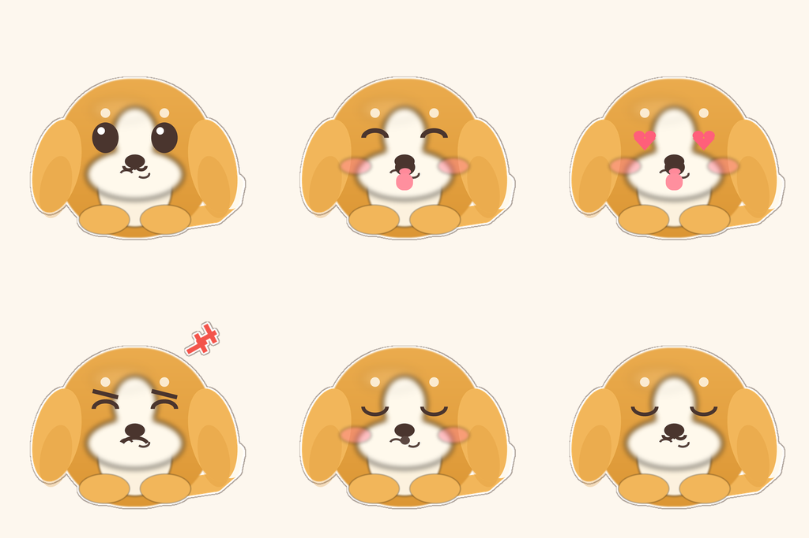
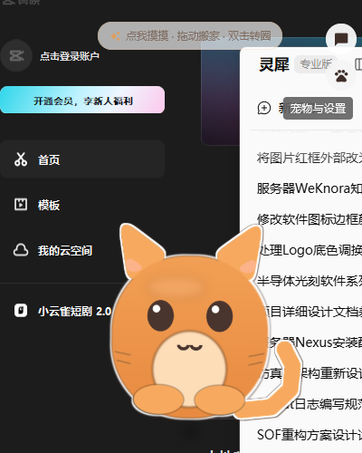
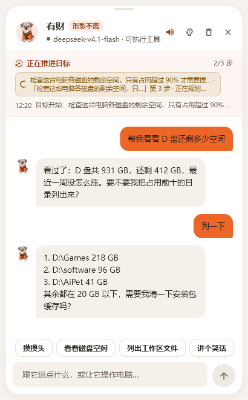
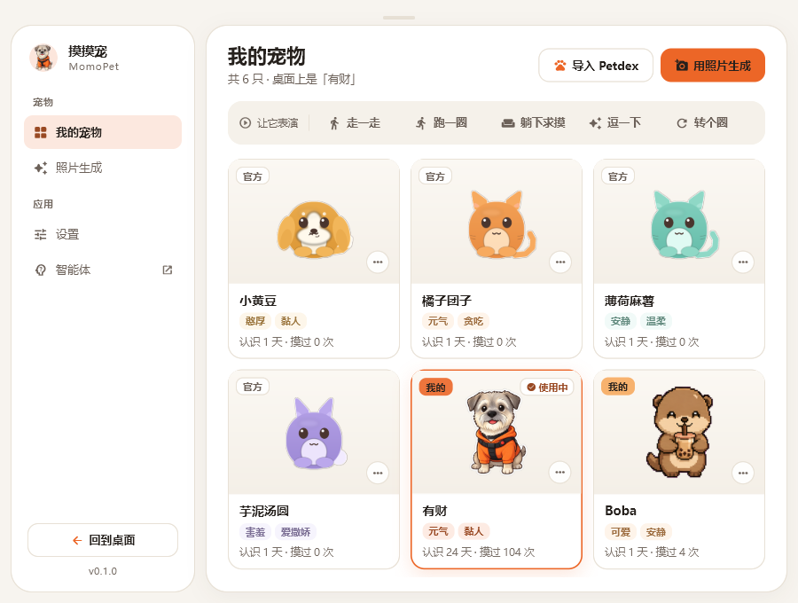
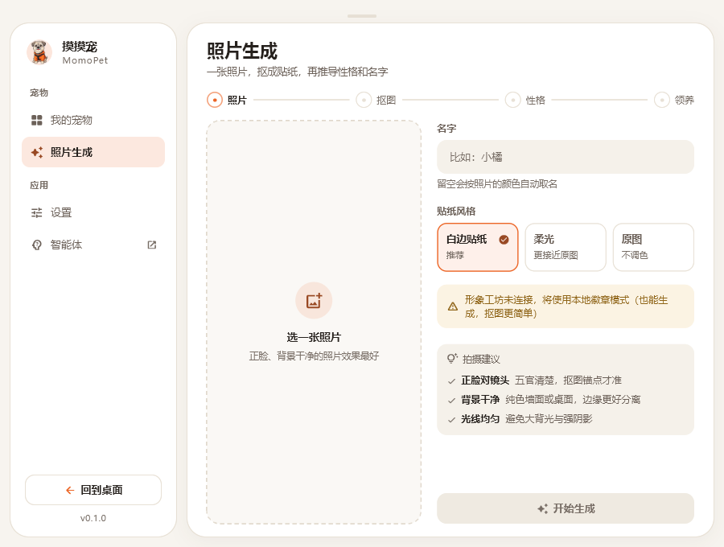
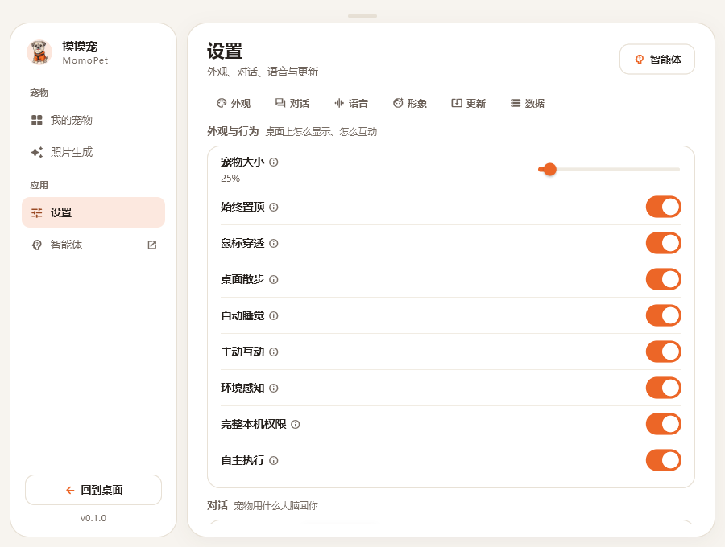

# 摸摸宠 MomoPet

把一张照片变成一只住在桌面上的 AI 宠物：透明无边框窗口、可以摸头、可以聊天、可以自己走动打瞌睡。
宠物形象由本地 Python 服务（PetForge）抠图生成，聊天可以离线（内置小脑），也可以接任意 OpenAI 兼容接口。

```
照片 ──► PetForge（抠图 / 贴纸化 / 配色 / 性格 / 锚点）──► petpack 宠物包
                                                          │
                        Flutter 桌面 / Android ◄───────────┘
```

<p align="center">
  
</p>

<p align="center">
  
  
  
</p>

<p align="center">
  
  
</p>

## 现状

| 模块 | 状态 |
| --- | --- |
| Windows 桌面端（透明置顶 / 鼠标穿透 / 托盘 / 拖动 / 走动 / 多显示器 / 睡觉） | 已完成，`flutter build windows` 通过 |
| 内置形象「小黄豆」（黄狗白面，6 种表情）+ 3 只旧宠物 | 已完成 |
| 照片生成宠物（在线 PetForge + 离线徽章兜底） | 已完成，接口与 CLI 端到端验证通过 |
| 照片宠物逐帧动画（walk / run / lie，程序化 + 可选 ComfyUI） | 已完成，512×512、去重、可选图集 |
| Petdex 范式动画（局部位移场 / 绕垂直轴转身 / 左右独立方向序列） | 已完成，13 个动作 67 帧，见 [Petdex 说明](docs/petdex.md) |
| ComfyUI 图生图流水线（SD1.5 + IP-Adapter） | 已完成，本机 RTX 5070 Ti 实测；有财 AI 精修 10 帧 |
| 逐帧播放（`AnimatedBuilder` + 单调时钟 + 预解码） | 已完成，修复了走动时帧不推进的 bug |
| 拖动走路（拖动时播放 walk 真帧，方向跟随拖动） | 已完成 |
| 聊天（本地小脑 / OpenAI 兼容后端 / 失败降级 / **流式逐字输出**） | 已完成，测试覆盖见「自检」 |
| 长期记忆（认识天数、被摸次数、话题、里程碑）+ 成长阶段 | 已完成 |
| 语音朗读（系统 TTS，可开关） | 已完成 |
| Android 系统悬浮窗（浮在其它 App 之上） | **APK 构建通过**（60.3MB）；Android 15 模拟器已验证跟随当前宠物、点击互动、覆盖桌面，真机待验证 |
| 托盘（nativeapi 新 API） | 已完成，`tray_manager` 0.8 原生接口 |
| 打包（MSIX / 压缩包 / 免安装绿色版）、CI（GitHub Actions） | 已完成，见下方「打包」与 `.github/workflows/ci.yml` |
| 自动更新（版本检查 / 下载 / sha256 校验 / 启动安装） | 已完成，10 个单元测试 |
| Petdex 宠物导入（本机 `~/.codex/pets`，真帧动画） | 已完成，3 个单元测试 |
| 主动行为（按性格搭话 / 讨食 / 求摸 / 小跑，设置可关） | 已完成，7 个单元测试 |
| 有财专属动作帧（idle / talk / eat / sleepy / spin）+ 投喂闭环 | 已完成，见 [宠物包格式](docs/petpack.md) |
| 状态中枢与面板按职责拆分（4 个 coordinator + 4 个 UI 文件） | 已完成，见 [架构说明](docs/architecture.md) |

### 本次验证结果

```text
flutter analyze                 No issues found
flutter test                    93 个用例（86 个历史通过 + 7 个主动行为新增；含 9 个多显示器、10 个自动更新、3 个 Petdex 导入）
PetForge 单元测试               9 个全部通过
PetForge 端到端（真实服务）     walk/run/lie 生成 + Dart 解析通过
ComfyUI（RTX 5070 Ti）          DreamShaper 8 + IP-Adapter；有财 AI 精修 walk/hop/lie 共 10 帧
flutter build windows --release momopet.exe 构建成功
flutter build apk --release     app-release.apk（60.3 MB，编译通过）
Android 模拟器（API 35）        SYSTEM_ALERT_WINDOW=allow；悬浮窗显示当前宠物、切宠物跟随、点击冒泡、按 Home 后仍在
启动冒烟                        进程存活，桌面截图可见宠物 / 气泡 / 粒子；WM_CLOSE 退出码 0
MSIX                            app/build/.../Release/momopet.msix（22.3 MB，测试证书）
免安装压缩包                    MomoPet-release.zip（17.4 MB，解压后可直接运行）
```

## 目录结构

```
AiPet/
├─ app/                      Flutter 客户端（Windows 桌面 + Android 悬浮窗）
│  ├─ lib/
│  │  ├─ core/               窗口形态枚举
│  │  ├─ data/               宠物仓库（assets + 用户目录）、设置持久化
│  │  ├─ models/             Pet / PetPack、ChatMessage、AppSettings
│  │  ├─ pet/                动画引擎（舞台、程序化动作、粒子）
│  │  ├─ services/           窗口、托盘、Win32 命中测试、聊天后端、PetForge 客户端
│  │  ├─ state/              AppController（装配 + 窗口形态）与 4 个 coordinator
│  │  │                      （pet_behavior / chat / generation / update）
│  │  ├─ ui/                 宠物外壳、聊天、气泡与组件；面板拆为
│  │  │                      panel_chrome / gallery_tab / create_tab / settings_tab
│  │  └─ mobile/             Android 悬浮窗入口
│  ├─ assets/                内置宠物（doudou / momo / mint / taro）、图标
│  ├─ test/                  单元测试
│  └─ windows/ android/      平台工程
├─ services/petforge/        Python 图像服务（FastAPI）
│  └─ petforge/              api / pipeline / persona / cli
├─ tools/make_builtin_pets.py        生成内置宠物的 6 种表情帧与图标
├─ tools/generate_pet_motion_frames.py  给单图宠物补 idle/talk/eat/sleepy/spin 动作帧（幂等）
├─ docs/                     架构、平台、宠物包格式、服务接口、路线图
└─ scripts/                  一键运行 / 构建 / 调试脚本
```

## 快速开始（Windows）

1. 安装 Flutter SDK（3.27+，实际验证版本 3.47.9）与 Visual Studio（含「使用 C++ 的桌面开发」工作负载）。
   语音插件 `flutter_tts` 的 Windows 实现要下载 CppWinRT，构建时会调用 `nuget.exe`；
   `scripts/run-desktop.ps1` 与 `build-windows.ps1` 没检测到 nuget 时会自动下载到 `%LOCALAPPDATA%\MomoPet\tools`。
2. 准备宠物形象服务（可选，不启动会自动用本地徽章模式）：

   ```powershell
   powershell -ExecutionPolicy Bypass -File scripts\start-petforge.ps1
   ```

   浏览器打开 <http://127.0.0.1:8787/docs> 可看到接口文档。

3. 运行桌面端：

   ```powershell
   powershell -ExecutionPolicy Bypass -File scripts\run-desktop.ps1
   ```

   或者先跑 `scripts\plugin-links.ps1`，再手动 `cd app; flutter run -d windows`。

4. 打包：

   ```powershell
   powershell -ExecutionPolicy Bypass -File scripts\build-windows.ps1 -Zip    # 免安装压缩包
   powershell -ExecutionPolicy Bypass -File scripts\build-msix.ps1            # MSIX 安装包
   ```

   产物在 `app\build\windows\x64\runner\Release\`（`momopet.msix` 约 22MB）。
   MSIX 用的是自动生成的测试证书：目标机器要么开着开发者模式，要么先信任该证书；
   有正式证书时改 `pubspec.yaml` 里的 `msix_config` 即可。

### 只想双击运行（两种免安装形态）

先跑一次 `scripts\build-windows.ps1`，然后按需选一种：

| 形态 | 命令 | 产物 | 怎么用 |
| --- | --- | --- | --- |
| 绿色版目录 | `scripts\build-portable.ps1` | `dist\MomoPet\` + `MomoPet-release.zip` | 双击目录里的 `momopet.exe`（或中文名副本 `摸摸宠.exe`），整个文件夹一起拷贝 |
| 单文件 exe | `scripts\build-single-exe.ps1` | `dist\MomoPet.exe`（约 26MB） | 单独拷到任意位置，双击即用 |

两个脚本都幂等可重跑。绿色版会跳过 msix / pdb / lib 并附上 `LICENSE`，零额外依赖；
单文件版需要 Python 3.9+ 与 PyInstaller（脚本会自动安装），首次双击把内嵌的绿色版
按内容哈希释放到 `%LOCALAPPDATA%\MomoPet\runtime\<hash>\` 再启动，之后直接启动，
exe 内容变化时自动释放新版本，异常写同目录的 `launcher.log`。

> **为什么 Flutter 原生 exe 不能单独拷走**：运行时必须和 `flutter_windows.dll`、
> 6 个插件 dll、`data\app.so` 与 `data\flutter_assets` 在同一目录。
> 单文件版的本质就是把这个目录打包进 exe、运行时释放，所以首次启动会慢 1~2 秒。
> 不想带 Python 打包链路时用绿色版即可，效果一样。

> 国内网络建议先设置镜像（脚本已内置默认值）：
> `PUB_HOSTED_URL=https://pub.flutter-io.cn`、`FLUTTER_STORAGE_BASE_URL=https://storage.flutter-io.cn`。

### 关于符号链接（很多人第一次会卡在这里）

Flutter 构建桌面端时要把插件源码目录符号链接到 `app\windows\flutter\ephemeral\.plugin_symlinks`，
而 Windows 默认只有**管理员**或**开发者模式**才能建符号链接。仓库里的 `scripts\plugin-links.ps1`
用普通用户也能创建的**目录联接（junction）**替代，Flutter 会直接复用。
如果已经打开了开发者模式，这个脚本不会做任何事，可以放心重复执行。

## 怎么玩

| 操作 | 效果 |
| --- | --- |
| 单击宠物 | 开心跳帧动画 + 冒爱心，互动 +1；点头部算 +2 |
| 双击宠物 | 转圈，好感度 +1 |
| 按住拖动 | 拎起来搬家，松手落地委屈趴一下，位置会被记住 |
| 长按 / 悬停右上按钮 | 打开聊天、打开管理面板 |
| 托盘图标 | 显示隐藏、打开聊天、切换鼠标穿透、退出 |
| `Esc` | 收起聊天 / 面板 |
| 空闲 90 秒 | 自动睡着；点一下叫醒 |
| 空闲 26~56 秒 | 自己在桌面上横着挪一小段，偶尔小跑（30%） |
| 空闲 35~75 秒 | 躺倒翻肚皮求摸摸；摸它奖励翻倍 |
| 面板宠物卡铅笔图标 | 给宠物起昵称（如有财），气泡和面板都显示昵称 |
| 面板「宠物大小」滑杆 | 0.15~1.5 倍缩放；默认是小尺寸（1/4） |
| 面板「我的宠物」动作按钮 | 走一走 / 跑一圈 / 躺下求摸 / 转个圈 / 逗一下（会先收起面板回到桌面形态） |
| 面板「逗一下」 | 立刻让宠物按性格主动来一次：搭话 / 讨食 / 求摸 / 小跑 |
| 讨食时点一下宠物 | 投喂成功：好感 +3、开心跳 + 专属答谢，讨食动画收起 |
| 空闲 3~6 分钟 | 按性格自己发起一次主动行为（设置 →「主动互动」可关） |

走路 / 奔跑 / 躺倒 / 开心跳 / 委屈落地都是**逐帧动画**（腿、尾巴、耳朵真实摆动），
不是简单旋转平移；走动时会按方向自动转向（向左跑 / 向右跑）；
照片生成的自定义宠物会由 PetForge 生成 `walk` / `run` / `lie` 帧（默认程序化变形，
512×512，零成本），生成时没要动画或旧宠物包则回退到程序化姿态（挤压 / 摆动）。

宠物以外的区域是**鼠标穿透**的：点桌面图标不会被宠物窗口挡住。

## 聊天后端

管理面板 →「对话」：

- **本地小脑**：内置关键词回复，离线可用，也是在线失败时的兜底。
- **在线模型**：填 Base URL + 模型名（+ 可选 Key），走 OpenAI 的 `/chat/completions`。
  默认 `http://127.0.0.1:11434/v1` + `qwen2.5:3b`，可以直接用 Ollama、LM Studio、DeepSeek、通义等。

宠物回复里可以带情绪标签（`[happy]` / `[love]` / `[angry]` / `[sleepy]` / `[idle]`），
标签决定表情与粒子效果；没有标签时按文本关键字猜。

在线模型**逐字流式输出**，等待不再干瞪眼；网络断了会自动整段降级到本地小脑。

### 长期记忆与成长

宠物会记住：认识了几天、被摸过多少次、聊过什么话题、发生过哪些里程碑（第一次说话、第 20/50/100 次摸头…）。
聊天窗口右上角的 🧠 按钮能看它「记得的事」，也能一键让它忘掉。

互动点（摸头 1 点 / 聊一轮 2 点）决定成长阶段：**初识 → 熟络 → 黏人 → 形影不离**，
阶段会写进给模型的提示词里，越熟语气越黏。

### 语音朗读

聊天窗口右上角的小喇叭（或设置里的「朗读回复」）打开后，用系统 TTS 把回复念出来，
会自动去掉情绪标签、颜文字和 markdown。Windows 用 SAPI，Android 用系统 TTS。

## 用照片生成宠物

管理面板 →「生成」→ 选一张照片 → 填名字（可留空自动取名）→ 生成 → 收养。

- 连上 PetForge 时：rembg / grabcut / 平板背景 / 圆形兜底 四级抠图链，加白色描边贴纸风格，
  自动提取配色、推导名字与性格、定位头部锚点，并生成 `walk` / `run` / `lie` 逐帧动画。
- 连不上时：本地「猫耳徽章」模式，把照片做成圆形徽章，保证流程能走通。

动画素材的免费生成途径（本地 ComfyUI 等）见
[宠物动画素材生成](docs/pet-generation.md)。

## 文档

- [架构说明](docs/architecture.md) —— 状态中枢、动画引擎、窗口与穿透的实现方式
- [界面设计](docs/ui.md) —— 设计令牌、组件清单、各界面要点与无障碍检查清单
- [平台说明](docs/platforms.md) —— Windows 透明窗口 / 鼠标穿透 / Android 悬浮窗 / 已知限制
- [宠物包格式](docs/petpack.md) —— `petpack.json` 字段含义与自制方法
- [PetForge 接口](docs/petforge-api.md) —— HTTP 与 CLI 用法
- [自动更新](docs/update.md) —— 版本检查清单、下载校验与安装流程
- [Petdex 导入](docs/petdex.md) —— 图集格式、状态映射与授权说明
- [宠物动画素材生成](docs/pet-generation.md) —— 免费路线、ComfyUI 配置、帧质量清单
- [路线图](docs/roadmap.md) —— 还没做的事

## 自检

```powershell
powershell -ExecutionPolicy Bypass -File scripts\check.ps1
```

脚本会先跑 `flutter pub get`，所以换机器 / 刚克隆仓库时直接执行即可，不必手动装依赖；
等价于 `flutter analyze` + `flutter test`（93 个用例）+ PetForge CLI 冒烟测试。
PetForge 的 9 个单元测试可以单独跑：`cd services\petforge; .\.venv\Scripts\python -m unittest discover -s tests -v`。
其中 `petforge_e2e_test` 会连本地 PetForge 做真实的「上传照片 → 生成宠物」端到端验证，
服务没启动时自动跳过；想用自己的照片跑：`PETFORGE_TEST_IMAGE=照片路径 flutter test test/petforge_e2e_test.dart`。
