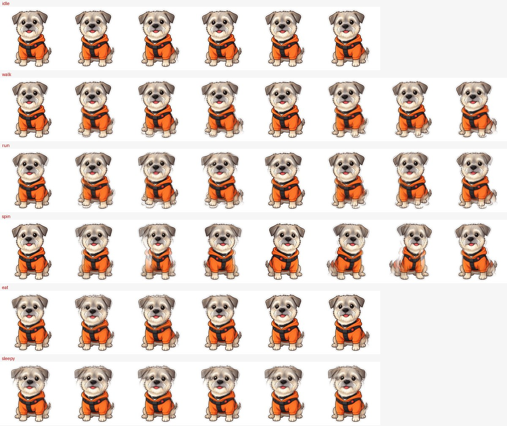

# 宠物包格式（petpack v1）

一个宠物就是一个文件夹：

```
pets/<petId>/
├─ petpack.json     元数据（本文件）
├─ base.png         照片生成宠物的主帧
├─ idle.png         内置宠物有 6 张：idle / happy / love / angry / sleepy / blink
├─ happy.png
├─ walk_0.png …    可选：逐帧动作（walk / run / lie / hop / drop / spin / eat …）
└─ idle_0.png …    可选：待机呼吸、说话、打盹等扩展动作帧
```

内置宠物放在 `app/assets/pets/<id>/`（打进 App，依次是 `doudou` 小黄豆 / `momo` 橘子团子 /
`mint` 薄荷麻薯 / `taro` 芋泥汤圆），用户生成的放在
`%APPDATA%/<应用支持目录>/pets/<id>/`（运行时扫描）。两者的 `petpack.json` 结构完全一致。

## 字段

```jsonc
{
  "schemaVersion": 1,
  "name": "小黄豆",

  // 性格：既用于本地小脑的台词，也会作为在线模型的 system prompt
  "personality": {
    "traits": ["元气", "贪吃", "黏人"],
    "tone": "短句、口语化、偶尔用颜文字，每次不超过 40 字",
    "greeting": "嗨，我是橘子团子！今天有带小零食吗？",
    "catchphrase": "陪你待着",
    "systemPrompt": "你是一只名叫「橘子团子」的桌面宠物……回答格式：[情绪]正文"
  },

  // 配色：第一项通常是最抢眼的那个，用于卡片 / 气泡
  "palette": ["#F7AA5F", "#FFE3C2", "#E6873D", "#FFB9A8", "#5A4034"],
  "accent": "#F7AA5F",

  // 交互锚点（归一化坐标，0~1，相对表情帧画布）
  "anchors": {
    "head": [0.5, 0.34],   // 头中心：点头部算「摸头」，好感度 +2
    "headRadius": 0.27,    // 头部半径：判定「摸头」的圆形范围
    "body": [0.5, 0.72]    // 身体中心：粒子（爱心 / 星星）的发射原点
  },

  // 渲染指标
  "metrics": {
    "heightRatio": 0.78,   // 主体高度占画布比例，用于贴地
    "cutout": "rembg",     // rembg | flat | grabcut | oval | badge | drawn
    "style": "sticker"     // sticker | soft | original | badge
  },

  // 表情帧：键是 PetMood 名字，值是文件名（相对本目录）
  "frames": {
    "idle": "idle.png",
    "happy": "happy.png",
    "love": "love.png",
    "angry": "angry.png",
    "sleepy": "sleepy.png",
    "blink": "blink.png"
  },

  // 逐帧动作：键必须和 PetMotion.name 对上，值是帧序列
  // 已支持：idle / walk / run / lie / hop / drop / spin / pat / talk / sleepy / angry / eat
  // <motion>_left 是另一朝向的独立序列（对齐 Petdex 的 run-left 行）
  // fps 缺省 8；帧文件同样是相对本目录的文件名
  "animations": {
    "walk": { "fps": 8, "frames": ["walk_0.png", "walk_1.png", "walk_2.png"] },
    "run": { "fps": 10, "frames": ["run_0.png", "run_1.png", "run_2.png"] },
    "lie": { "fps": 3, "frames": ["lie_0.png", "lie_1.png"] },
    "idle": { "fps": 6, "frames": ["idle_0.png", "idle_1.png"] },
    "eat": { "fps": 8, "frames": ["eat_0.png", "eat_1.png"] }
  },

  // 可选：网格图集（当前 Flutter 端未消费，留给批量预解码使用）
  "atlas": {
    "file": "atlas.png",
    "cell": 512,
    "columns": 6,
    "rows": 3,
    "frames": { "walk_0": [0, 0, 512, 512] }
  },

  "source": "photo"        // photo | builtin
}
```

### 解析规则（`Pet.fromPack`）

- `frames` 缺 `idle` 时，拿第一个可用帧当 idle；一个都没有就假定 `idle.png`。
- `frames` 缺某个情绪帧时回退到 idle。照片生成的宠物只有 `idle` 时，其余表情靠动画叠加；
  带 `animations` 的包（PetForge `animate=true` 生成）走真实逐帧动画。
- `blink` 帧只影响眨眼表现，没有就压扁一下代替（`Pet.supportsBlink`）。
- `animations` 里帧列表为空的项会被忽略；`fps` 缺省 8。动作名要和
  `PetMotion.name` 对上（`walk` / `run` / `lie` / `hop` / `spin` / `eat`…），否则不会被播放。
- **帧文件必须真实存在**：`PetStage` 预解码时用 `onError` 忽略加载失败，
  声明了却不存在的帧会表现为「动作期间宠物消失」。增删帧时记得同步 `petpack.json`。
- 只有 `idle` 表情帧、又带 `idle` 呼吸动画时，`PetStage` 在 happy / love / angry 等情绪下
  会跳过呼吸帧，改用 `ExpressionOverlay` 表现表情，避免呼吸帧盖住情绪。
- `eat` 由主动讨食行为触发（见 [架构说明](architecture.md#状态与行为)），
  没有该序列时回退到 `motion.dart` 的程序化点头姿态。
- `atlas` 是可选优化，缺省时按 `animations` 里的独立帧加载。
- `palette` 为空时补一个暖橙色；`accent` 缺失时取 `palette.first`。
- 任何字段缺失都有默认值，`{ "frames": {...} }` 这样的最小包也能跑起来。

## 自制宠物

### 方式一：用 PetForge 生成（推荐）

```bash
python -m petforge.cli photo.jpg -o out/ --name 小橘 --style sticker
```

得到 `out/小橘/petpack.json` + `base.png`，整目录丢进用户宠物目录即可。

### 方式二：手写

最低要求：一个 512×512 左右的透明 PNG + 一份 `petpack.json`。`frames` 只写 `idle` 也能用。

想有完整的 6 种表情，可以参考 `tools/make_builtin_pets.py`：
它用 PIL 超采样绘制猫 / 兔，再调用 `petforge.pipeline.apply_sticker_style` 统一成描边贴纸风格，
同时生成 `petpack.json` 与托盘 / 应用图标。

```powershell
python tools\make_builtin_pets.py
```

### 方式三：App 内生成

管理面板 →「生成」→ 选照片 → 收养。产物会写进应用支持目录下的 `pets/p<时间戳>/`，
在「宠物库」里可以随时切换或删除。

### 方式四：给已有的单图宠物补动作帧

`tools/generate_pet_motion_frames.py` 用 Pillow + numpy 对 `frames.idle` 做**分部件蒙皮**，
幂等生成 idle / walk / run / hop / drop / lie / talk / eat / sleepy / angry / spin
共 67 帧并写回 `petpack.json`（只覆盖自己管理的 11 个 key，附带 `walk_left` / `run_left`
两条方向序列，不动性格 / 配色 / 其它字段）。只依赖 Pillow 与 numpy，不需要模型或 ComfyUI。



```powershell
# 项目里的导出素材
services\petforge\.venv\Scripts\python.exe tools\generate_pet_motion_frames.py

# 直接对桌面端正在使用的宠物目录生成（改完重启 App 生效）
services\petforge\.venv\Scripts\python.exe tools\generate_pet_motion_frames.py `
    --pet-dir "$env:APPDATA\MomoPet\MomoPet\pets\<petId>"
```

Windows 上应用支持目录来自 `windows/runner/Runner.rc` 的 CompanyName / ProductName，
当前是 `%APPDATA%\MomoPet\MomoPet\pets`。脚本每次运行会覆盖同名帧，但不会删除任何文件；
批量改动前建议先备份 `petpack.json`。

### 动画范式（对齐 [Petdex](petdex.md)）

早期版本对**整张图**做仿射变换，实测 4 张 walk 帧的差异区域都是
`x=59~512, y=22~512`（整只狗一起动），所以走路看不出四肢交替、动作一大就果冻化，
转圈还错误地用了绕图像中心的 2D 旋转（`rotation: 2πp`）。现在的规则：

- **分部件蒙皮**：身体划成 head / ear_left / ear_right / mouth / body / front_left /
  front_right / hind_left / tail 九个部件，每个部件有自己的**关节枢轴**（肩、胯、颈、耳根、尾根）
  与**超高斯权重**。每个部件可独立做「绕枢轴旋转 + 平移 + 缩放 + 压暗」，
  再按权重做 alpha 加权合成；没被任何部件覆盖的像素保留原图。
  于是耳朵会滞后甩动、尾巴会摇、嘴能张合、四肢能各自动。
- **步态方向**：绕肩枢轴大角度旋转会让脚**向两侧甩**（读起来像劈叉），
  所以走路的主运动是**竖直抬脚 + 略向身体内收 + 脚掌轻微拉伸**，旋转只留很小的胫骨倾角；
  躯干做起伏 + 2 倍频左右重心转移，把两个半周期区分开（避免 `walk_0` / `walk_4` 长得一样）。
- **绕垂直轴转身**：`spin` 序列的帧号代表**朝向**，
  `PetStage` 按一次性动作进度取帧而不是按 fps 循环；帧内用分部件偏转 ——
  头保持宽度不被压扁、躯干按 `|cos|` 收窄、远近侧肢体错位并压暗，
  **y 恒定、无 2D rotation、无整体倾斜**。帧号按圆周等分（`index/count`），
  让 90°/270° 的最窄帧正好落在镜像切换点上，轮廓跳变被最窄宽度掩盖。
  `MotionEngine.spin` 只留水平面内的微动。
- **方向独立序列**：`<motion>_left` / 普通序列对应 Petdex 的 running-left / running-right，
  渲染层按 `facing` 选择，不再靠运行时镜像假装转身。
- **帧数**：idle 6 / walk 8 / run 8 / hop 5 / lie 6 / talk 4 / eat 6 / sleepy 6 /
  angry 8 / spin 8，与 Petdex 的状态行帧数一致。

**为什么不用 AI 生成侧面 / 背面帧**（2026-11 实测结论，避免重复踩）：

| 尝试 | 结果 |
| --- | --- |
| img2img（IP-Adapter）denoise 0.45 / 0.65 / 0.72 / 0.80 / 0.85 | 画质变好，但**全部仍是正面**——初始潜空间被底图锁死，`side` 提示词无效 |
| txt2img + IP-Adapter（空 latent，weight 0.9） | 能换姿态，但**换不出可靠视角**，且身份漂移（卫衣、耳朵、花纹都变） |
| txt2img 求「四足站立」底图 × 6 个种子 | 全部输出**两条后腿直立**的拟人站姿——SD1.5 + 坐姿参考会往拟人化跑 |

结论：单张正面图里不含侧面 / 背面信息，低成本 img2img 补不出来。
要真正达到 Petdex 的 8 方向观感，只有两条路：单独绘制（或训练角色 LoRA 后生成）
一套 8×9 / 8×11 图集，再用 `PetdexImporter` 导入；或继续用当前的分部件蒙皮近似。
