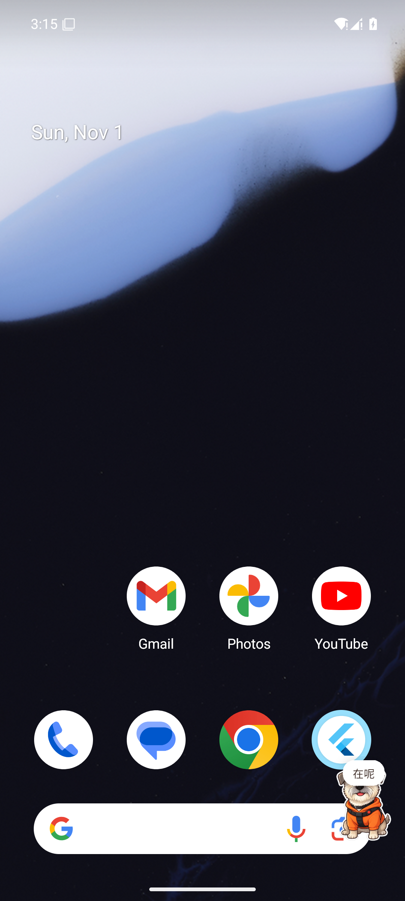

# 平台说明

## Windows（主要目标平台）

### 透明与无边框

窗口由 `window_manager` 以 `skipTaskbar: true`、`TitleBarStyle.hidden`、透明背景创建，
再交给 `flutter_acrylic` 的 `WindowEffect.transparent` 让背景真正透出桌面。

顺序很重要：`Window.initialize()` → `setEffect(transparent)` → `waitUntilReadyToShow(...)`。
如果 acrylic 初始化失败（旧系统 / 显卡驱动异常），代码会 `debugPrint` 后继续，
此时窗口背景变成不透明——功能不受影响，只是没有那么好看。

### 鼠标穿透

窗口默认穿透，只有光标进入宠物矩形时才「变实」（详见 [architecture.md](architecture.md#鼠标穿透仅-windows)）。
实现依赖 `win32` 6.x：

- `FindWindow(null, PCWSTR(title))` 返回 `HWND`，句柄为 0 表示没找到。
- 读矩形 / 光标位置要用 `.value`（`Win32Result<T>` 包装）。
- 物理像素 ÷ `dpr` 才是 Flutter 的逻辑坐标，多显示器不同缩放也能对上。

`window_manager` 的 `setIgnoreMouseEvents(true)` 在部分旧版本上会抛异常，代码里已 try/catch，
失败时退化为不穿透（能点、但会挡住桌面），不会崩溃。

可点击的区域有两块，都会参与命中判定：

| 区域 | 来源 |
| --- | --- |
| 宠物本体 | `PetStage` 每次布局后写 `WindowService.hitRect` |
| 气泡 + 右上角两个圆按钮 | `PetView` 写 `WindowService.uiRect`（两者的并集） |

> 小细节：窗口从「穿透」切回「可交互」时，系统不会补发一次鼠标移动事件，
> 所以偶尔会遇到「鼠标刚移进去，按钮还没出现，再动一下才出现」。
> 这是 Windows 的消息机制，不是卡顿。

### 多显示器

`screen_retriever` 的 `Display.visiblePosition + visibleSize` 是逻辑像素工作区（已扣掉任务栏），
`services/display_bounds.dart` 负责：

- 用窗口与各显示器工作区的**重叠面积**选当前显示器（跨屏时选面积大的）；
- 走动、切换窗口形态、恢复上次位置时都夹到这块显示器；
- 支持左侧负坐标副屏、上下排列；窗口完全在屏幕外时取中心最近的显示器。

宠物不会自动跨屏走动：拖到哪块屏，就在哪块屏里活动。
边界逻辑有独立单测：`app/test/display_bounds_test.dart`。

> 本机只有一块 100% 缩放的显示器；混合 DPI（如主屏 150% + 副屏 100%）尚未实测。
> 代码统一使用 `screen_retriever` 的逻辑像素工作区，`window_manager` 的位置也按逻辑像素处理。

### 托盘

`tray_manager` 0.8 用 `nativeapi` 的新 API：`TrayIcon.create()` + `Menu` / `MenuItem` +
事件监听（`TrayIconClickedEvent` / `MenuItemClickedEvent`），不再走 0.5.x 的 deprecated 兼容桥。

- 图标直接加载打包进应用的 `assets/icons/app_icon.png`（`ImageAsset.fromAsset`），不用再落临时文件。
- **托盘与任务栏图标统一换成「有财」**：`tools/make_youcai_icons.py`（幂等）以
  `exports/有财/base.png` 为母版，一次生成 `app_icon.png`、`app_icon.ico`、`tray.ico`
  和 `windows/runner/resources/app_icon.ico`（8 帧多尺寸）。任务栏走 `Runner.rc` 的
  `IDI_APP_ICON`，托盘走上面的 png，两者同源；托盘 tooltip 为「有财 · 摸摸宠 MomoPet」。
  重跑方式：`services/petforge/.venv/Scripts/python.exe tools/make_youcai_icons.py`。
- 鼠标穿透做成菜单里的 checkbox，状态由 `TrayService.setClickThrough` 同步；
  托盘左键 = 显示/隐藏，右键 = 弹菜单，双键 = 打开聊天。
- 资源释放走 `destroy()`：先解绑监听，再 `Menu.dispose()` / `TrayIcon.dispose()`。

### 符号链接与开发者模式

`flutter build windows` / `flutter run` 会把插件目录符号链接到
`app\windows\flutter\ephemeral\.plugin_symlinks\`。Windows 默认普通用户建不了符号链接，会报：

```
Building with plugins requires symlink support.
Please enable Developer Mode in your system settings.
```

两种解法，任选其一：

1. 开启开发者模式：`start ms-settings:developers`（需要管理员确认）。
2. 用仓库脚本建目录联接：`powershell -ExecutionPolicy Bypass -File scripts\plugin-links.ps1`。
   目录联接普通用户即可创建，Dart 会把它识别成 `Link`，Flutter 检测到已指向正确目标就跳过创建。

脚本可以重复执行；已经开开发者模式时不会有副作用。

### nuget（语音插件的构建前置）

`flutter_tts` 的 Windows 实现走 C++/WinRT，构建时 CMake 会调用 `nuget.exe` 下载
`Microsoft.Windows.CppWinRT`。没装 nuget 时构建直接失败：

```
[ERROR] Exception: nuget.exe not found
```

`scripts/run-desktop.ps1` / `scripts/build-windows.ps1` 会自动检测并把 nuget.exe 下载到
`%LOCALAPPDATA%\MomoPet\tools`（首次需要能访问 dist.nuget.org / api.nuget.org）。
手动构建时自己把 nuget.exe 放进 PATH 即可。

### 已知限制

- 透明 + 置顶窗口在远程桌面 / 某些显卡驱动下可能表现为黑底，改用 `WindowEffect.mica` 可缓解。
- 窗口不可缩放，缩放只通过设置里的 `scale` 影响宠物尺寸：面板滑杆 0.15~1.5 倍，
  默认 0.25（原精灵的 1/4），配置解析时再 clamp 到 0.1~3.0。
- 走动时只做横向位移，不会自动避让其它窗口。

## Android（悬浮窗）

### 配置

`app/android/app/src/main/AndroidManifest.xml` 已声明：

```xml
<uses-permission android:name="android.permission.SYSTEM_ALERT_WINDOW"/>
<uses-permission android:name="android.permission.FOREGROUND_SERVICE"/>
<uses-permission android:name="android.permission.FOREGROUND_SERVICE_SPECIAL_USE"/>
<service android:name="flutter.overlay.window.flutter_overlay_window.OverlayService"
         android:foregroundServiceType="specialUse" ... />
```

另外 `android:usesCleartextTraffic="true"`：本机和局域网上的 LLM / PetForge 都是 `http://`，
不开这个 Android 9+ 会直接拒绝请求。

### 行为

- `MobileOverlay.show(pet: active)`：检查权限 → 没有就 `requestPermission()` → 写当前宠物快照 →
  `showOverlay()` → 后台重试 `shareData`。
- 悬浮窗是**独立的 Flutter Engine**，拿不到主 App 的 `AppController`，而且 overlay 引擎
  不会注册 `path_provider` / `shared_preferences` 这些插件。所以主 App 把当前宠物的
  `petpack` + 目录写成 `overlay_pet.json`（临时目录），并通过 `shareData` 推一份；
  `OverlayPet` 只用 `dart:io` 读文件，每 2 秒检查 mtime。切换宠物时
  `AppController.selectPet` / `adoptPreview` / `deletePet` 会调用 `MobileOverlay.sync`
  重写并推送，悬浮窗随之更新。
- 读不到主 App 数据（首次启动、权限异常、文件损坏）时回退到内置 `momo`。
- 点击悬浮窗换表情 + 冒泡，长按关闭；内置宠物有 happy / love / angry 帧，照片宠物
  只有 idle 帧时至少会冒泡反馈。
- 授权被拒绝时 `AppController.toggleMobileOverlay` 会把提示写进 `chatError`，设置页能看到。

### 模拟器验证（2026-11-01）

在 Android 15（API 35，x86_64 Google APIs）模拟器上实测：

```text
appops: SYSTEM_ALERT_WINDOW: allow
OverlayService: isForeground=true, foregroundServiceType=0x40000000 (specialUse)
主 App 切到「薄荷麻薯」→ 悬浮窗显示绿色薄荷麻薯
主 App 切到「芋泥汤圆」→ 悬浮窗 2 秒内变成紫色芋泥汤圆
推送自定义照片宠物「有财」→ 悬浮窗显示 base.png
按 Home 回到桌面 → 悬浮窗仍在，点击冒出「在呢」
```



### 构建前置

Android 构建需要 **JDK 17** 和 **Android SDK**（`platform-tools` / `platforms;android-36` /
`build-tools;36.0.0`），脚本从环境变量读：

```powershell
$env:JAVA_HOME = 'D:\software\jdk\jdk-17.0.20.1+1'
$env:ANDROID_HOME = 'D:\software\android-sdk'
powershell -ExecutionPolicy Bypass -File scripts\build-android.ps1
```

两个坑：

1. `sdkmanager` 在某些网络环境下拉 Google 仓库会一直卡在「Fetch remote repository」——
   是 Java 走 IPv6 的问题，`scripts/build-android.ps1` 已自动加 `-Djava.net.preferIPv4Stack=true`。
2. `app/android/local.properties` 里要写 `sdk.dir` 和 `flutter.sdk`（由 `flutter create` 生成，
   换机器时手动改路径；这个文件不进版本库）。
3. `:android_file_picker:compileReleaseKotlin` 可能报 `Could not close incremental caches`——
   Kotlin 增量编译的 mmap 缓存写不进去。`android/gradle.properties` 已加 `kotlin.incremental=false`
   规避（代价是插件每次全量编译，多花十几秒）。

已验证产物：`flutter build apk --release` → `app-release.apk`（60.3MB，minSdk 24 / targetSdk 36），
`aapt` 检查确认 `SYSTEM_ALERT_WINDOW` / `FOREGROUND_SERVICE_SPECIAL_USE` 权限和
`OverlayService` 均已打入清单。

### 已知限制

- iOS 不允许跨 App 悬浮窗，`MobileOverlay.show()` 在 iOS 上直接返回 false。
- 已在 Android 15（API 35）模拟器验证；**真机尚未验证**，部分厂商 ROM 对
  「后台启动前台服务 / 悬浮窗权限」有额外限制，需要真机确认。
- 照片宠物如果只有 `idle` 帧，点击悬浮窗只冒泡、不换表情（内置宠物有 happy/love/angry 帧）。

## macOS / Linux

`WindowService` 里的透明、置顶、`startDragging` 走的是 `window_manager` + `flutter_acrylic` 的跨平台接口，
理论上可用，但没有平台工程目录、也没有实测。需要时执行：

```bash
cd app && flutter create --platforms=macos,linux .
```

再补充 `Info.plist` / 桌面文件等打包配置。

## 环境变量（国内网络）

```powershell
$env:PUB_HOSTED_URL = 'https://pub.flutter-io.cn'
$env:FLUTTER_STORAGE_BASE_URL = 'https://storage.flutter-io.cn'
```

`scripts/_common.ps1` 里的 `Initialize-FlutterEnv` 会在未设置时自动补上这两项。
